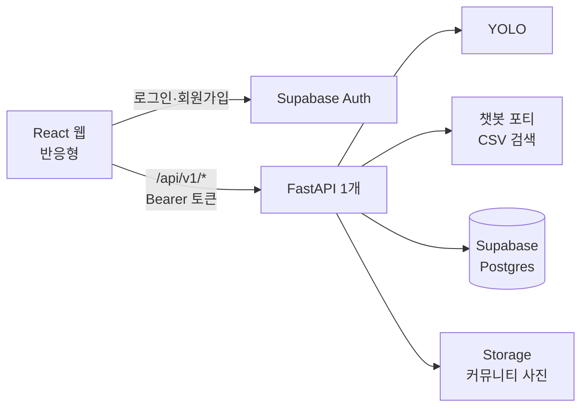
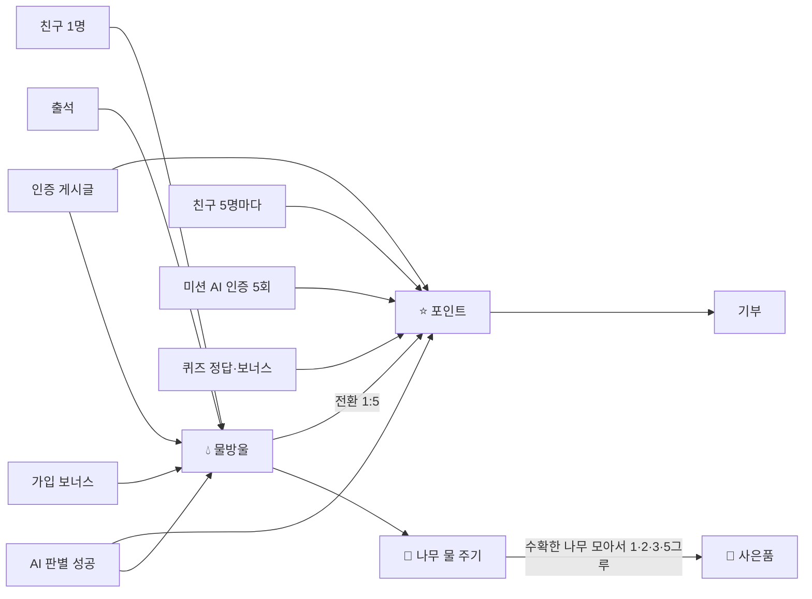
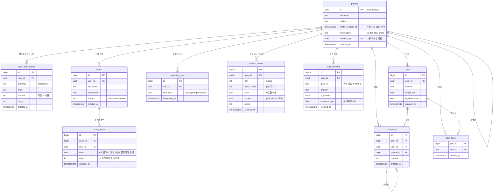

# RePick API 명세 · 보상표 · ERD

> **이 파일이 최신 기준입니다 (v0.5.10, 2026-10-22).** 노션 "RePick API 명세 · ERD (v0.4)"와 "물방울·포인트 보상표"는 이전 기록이에요.
> 다르게 만들고 싶으면 **먼저 이 파일을 고치고(PR) 팀에 알립니다.** 숫자·규칙이 바뀌면 이 파일 한 곳만 고칩니다.
>
> 표시: ✅ 결정됨 · ❓ 팀이 정할 것 · ⏸ 보류 · 🔒 로그인 필요 · 🔴 필수 · 🟡 2차

## 목차

0 한눈에 보기 · 1 공통 규칙 · 2 회원 · 3 AI 판별 · 4 챗봇 · **5 보상표** · 6 나의 숲 · 7 커뮤니티 · 8 이벤트·친환경샵·기부 · 9 ERD · 10 아직 정할 것 · 바뀐 기록

---

## 0. 한눈에 보기

### 담당

| 담당 | 기능 | API |
| --- | --- | --- |
| 현숙 | 회원가입·로그인, Supabase DB 전체(SQL 일괄 작성) | `/me` |
| 지원 | 마이페이지 (회원 정보·로그아웃, 잔액·나무, 쿠폰함, 내 활동) — 10/21 PR #30 | `/me`, `/me/coupons`, `/me/activity`, `/points`, `/forest` 읽기 |
| 경난 | 카메라(AI 판별), 물방울, 포인트, **나의 숲**(10/16 변경) | `/classify`, `/points`, `/forest` |
| 지원 | 기부, 이벤트·미션(퀴즈·출석·친구 초대), 친환경샵, 수거함 지도 | `/events`, `/friends`, `/donations` |
| 선영 | 챗봇 포티, 커뮤니티 | `/chat`, `/posts` |

### 전체 구조



- ✅ **쓰기는 모두 FastAPI로만.** 브라우저가 Supabase에 직접 하는 건 로그인뿐. 새 테이블은 RLS를 켜고 브라우저 접근을 막음
- FastAPI에서 내 데이터를 다룰 때는 반드시 `.eq("user_id", user["id"])`
- 화면에서 FastAPI 부르기: `useApi` · `api` ([docs/frontend-api.md](frontend-api.md)) / 서버에서 로그인 확인: `get_current_user` ([docs/backend-auth.md](backend-auth.md))

### 물방울 vs 포인트



- 💧 **물방울** = 나무 키우기. 포인트로 전환 가능 (**1💧 = 5⭐**) — ⏸ 전환 기능은 **맨 마지막 단계**에 구현
- ⭐ **포인트** = 기부에 사용. 포인트로 사은품을 **사는 기능은 없음** (친환경샵도 외부 링크)
- 🎁 **사은품** = 나무 수확 보너스 (6번)
- 잔액은 저장하지 않고 **거래내역 합계로 계산** (통장 하나에 화폐 칸만 다름 → 9번)

---

## 1. 공통 규칙

| 항목 | 규칙 |
| --- | --- |
| Base URL | `/api/v1` (예: `POST /api/v1/classify`) |
| 인증 | 🔒 API는 `Authorization: Bearer <access_token>` 필수, 없으면 `401` |
| 회원 ID | `auth.users.id` = `profiles.id`. FastAPI는 `get_current_user`가 주는 `user["id"]`만 쓴다. body·주소로 받지 않음 |
| 시간 | DB는 UTC 저장. **하루 한도는 한국 시간(`Asia/Seoul`) 0:00:00~23:59:59** 기준 |
| 사진 | 최대 **5MB**, 이미지만. 판별 사진은 서버에 저장하지 않음 (3번) |
| 에러 모양 | FastAPI 기본 `{"detail": "..."}` (회원 API가 이미 이 모양, 화면의 `ApiError`가 이 문구를 보여 줌) ❓ 팀 확인 |
| 숫자 | 보상 개수·한도·단계는 DB가 아니라 **코드 위쪽의 표(딕셔너리)**에 모아 둠 → 바뀌면 그 표와 이 파일만 고침. **예외: 나의 숲**(단계별 물방울·사은품 이름)은 `007` DB 함수 안에 있음 (6번) |

---

## 2. 회원 · 프로필 — 현숙 🔴 ✅ 구현 완료

- ✅ **이메일 회원가입만.** 소셜 로그인(카카오·네이버·구글·애플)은 **제외**
  > 이유: 소셜 로그인은 우리 가입 화면을 건너뛰어서 사진 공개 **필수 동의**(`photo_consent_at`), **닉네임·자치구**가 안 들어와요. 넣으려면 "첫 로그인 후 추가 정보 화면"이 따로 필요해요.
- ✅ 가입 화면: 이메일·비밀번호(6자 이상)·닉네임(최대 20자)·**자치구(서울 25개 구 목록)**·**사진 공개 필수 동의**(체크 안 하고 누르면 안내, 가입 불가)
- ✅ 가입하면 **물방울 3개 자동 지급** (`signup_bonus`, 가입 트리거 — `004`)
- ✅ 로그인이 필요한 화면: `/scan`, `/forest`, `/mypage`, `/points` (문지기 `RequireAuth`). `/donate`는 로그아웃 상태에서도 둘러보기, 기부할 때만 로그인 (PR #35, 10/22)
- ✅ 가입 화면 **추천인 코드 (선택)** (PR #36, 10/22): 초대 링크 `/signup?invite=코드`로 오면 미리 채움. 가입 후 `POST /friends` 한 번 → 코드가 틀려도 가입은 막지 않고 알림만
- ✅ 시작 화면(`/welcome`)은 안 씀 → 로그인 화면으로 이동 (원본은 `WelcomePage.backup.jsx`)
- ✅ 마이페이지 (지원, PR #30 10/22 merge): 닉네임·자치구 보기·수정(`PATCH /me`), 로그아웃 → 홈, 잔액·나무, 쿠폰함 `GET /me/coupons`, 내 활동 `GET /me/activity`(내 글·받은 댓글·내가 쓴 댓글, 각 최근 20개). 나의 기부 내역은 기부하기 화면 아래로 옮김

> **참고 (개인정보):** 실제 서비스라면 꼭 필요하지 않은 동의를 필수로 받으면 안 된다는 개인정보 규칙이 있다. 그래서 동의 문구를 "커뮤니티에 직접 올린 사진은 다른 회원에게 공개됩니다"처럼 쓰는 게 좋다. 이러면 서비스 이용 약관 성격이 돼서 자연스럽다.

### `GET /me` 🔒

```json
{
  "id": "uuid",
  "email": "nana@example.com",
  "nickname": "김나나",
  "region": "강서구",
  "created_at": "2026-10-10T12:00:00+00:00"
}
```

- 잔액·나무 단계는 `/me`에 넣지 않고 `GET /points`, `GET /forest`를 따로 부름 (추천) ❓

### `PATCH /me` 🔒

요청 `{"nickname": "나나", "region": "중구"}` → 응답: `GET /me`와 같음. 보낸 값만 바뀜, 각 최대 20자, 닉네임 빈칸 불가

---

## 3. AI 판별 (카메라) — 경난 🔴

### `POST /classify` 🔒 — 사진 → 품목 판별 + 적립

요청: `multipart/form-data` (`image`, 최대 5MB)

```json
{
  "status": "success",
  "scan_id": 128,
  "top": {"class": "CAN", "label_ko": "캔", "confidence": 0.91},
  "detections": [
    {"class": "CAN", "label_ko": "캔", "confidence": 0.91, "bbox": [120, 80, 340, 560]}
  ],
  "guide": {
    "category": "캔류",
    "disposal_method": "내용물을 비우고 헹궈 뒤 찌그러뜨려 배출",
    "notes": "스프레이는 구멍을 뚫어 가스를 뺀 뒤 배출"
  },
  "drops_awarded": 3,
  "points_awarded": 30,
  "drops_balance": 13,
  "points_balance": 250,
  "today_scan_count": 3,
  "elapsed_ms": 820
}
```

- ✅ **판별 클래스는 6개** (5번 보상표). 유리(`GLASS`)는 YOLO 학습에서 빠져서 제외 (10/16). 성공하면 **물방울과 포인트를 동시에** 지급
- ✅ **AI 판별은 제한 없음. 적립만 클래스 상관없이 합쳐서 하루 5회** ("클래스별 1번" 같은 제한 없음, 10/16). 6번째부터는 판별만 하고 `drops_awarded: 0`, `points_awarded: 0`
- 불확실할 때: `"status": "uncertain"`, `top: null`, 적립 0, `"message": "다시 찍어 주세요"`
  - ✅ **품목을 못 찾거나 6개 클래스가 아니면 `scans`에 저장하지 않음** (10/21) → 응답 `"scan_id": null`. `scans.top_class`가 not null이라 저장하면 DB가 거부함(500). 실패 횟수 통계는 쓰지 않음
- ✅ **판별 사진은 서버·DB에 저장하지 않음.** 화면의 저장 버튼 → 사용자 기기(다운로드 폴더). 커뮤니티 글 올릴 때만 Storage에 저장 (7번)
- `bbox`는 원본 사진 픽셀 기준 `[x1, y1, x2, y2]`
- 실시간 캠: 시연 때만. 시연용 **적립 없는 미리보기** 주소가 필요하면 따로 둠 ❓
- ⏸ 성공 기준 신뢰도: **YOLO 테스트가 끝나면 결과를 보고 경난이 정해서 올림** (10/19)
- ❓ 클래스 영문 이름이 실제 학습 클래스와 같은지 (경난)

---

## 4. 챗봇 포티 — 선영 🔴 ✅ 연동 완료

### `POST /chat`

```json
// 요청
{"message": "중구 3인용 소파 버리려면?", "district": "중구"}

// 응답
{
  "answer": "🌱 안녕하세요, 포티예요! ...",
  "answer_format": "markdown",
  "type": "large_waste",
  "sources": ["중구 대형폐기물 수수료"]
}
```

- 로그인 불필요. 외부 LLM 없이 CSV 검색 + 규칙으로 답함 (`backend/data/*.csv`)
- `type`: `large_waste` / `general` / `unsupported`
- 남은 것: 폰 화면(`ChatMobile`) 연결

---

## 5. 보상표 — 물방울 · 포인트 — 경난 🔴

> 성공·달성 1번 = 통장(`point_transactions`)에 **화폐마다 한 줄씩**. 예: 캔 판별 = `drop +3` 한 줄 + `point +30` 한 줄

### AI 판별 (클래스 6개)

| class | label_ko | 💧 물방울 | ⭐ 포인트 |
| --- | --- | --- | --- |
| `PAPER` | 종이 | 1 | 10 |
| `PET` | 페트병 | 1 | 10 |
| `PLASTIC` | 플라스틱 | 1 | 10 |
| `VINYL` | 비닐 | 1 | 10 |
| `CAN` | 캔 | 3 | 30 |
| `BATTERY` | 건전지 | 4 | 40 |

- 유리는 판별 클래스가 아님 (학습에서 빠짐). 유리병을 찍으면 다른 품목으로 나오거나 `uncertain` → 배출 방법은 챗봇 포티가 안내
- 판별 무제한, **적립은 클래스 합계 하루 5회**. type `scan`, `ref_id` = `scans.id`

### 그 밖의 적립

| 언제 | 💧 | ⭐ | 한도 | type | 담당 화면 |
| --- | --- | --- | --- | --- | --- |
| 회원가입 보너스 | 3 | — | 최초 1번 (DB 자동) | `signup_bonus` | 현숙 |
| 출석 체크 | 1 | — | 하루 1번 (DB가 막음) | `attendance` | 지원 (이벤트) |
| 출석 **7일 연속** 보너스 | **7** | — | 한 주(**월~일 고정**, 한국 날짜)에 월요일부터 일요일까지 하루도 빠짐없이 출석하면, 일요일 출석 때 1번 | `event` | 지원 (이벤트) |
| 친구 1명 초대 | 2 | — | 제한 없음 | `referral` | 지원 |
| 친구 5명 달성 | — | **1000** | 5명마다 (보상 후 0명부터 다시) | `referral_bonus` | 지원 |
| 퀴즈 정답 | — | **10** (1문제당) | 하루 3문제, 문제마다 **처음 맞힐 때 한 번만** (다시 풀어 맞혀도 받음) → 하루 최대 30 | `quiz` | 지원 |
| 퀴즈 3개 **모두 정답** 보너스 | — | **50** | 하루 1번 (다시 풀기로 3개를 다 맞혀도 받음) | `quiz` | 지원 |
| 미션: AI 인증 5회 달성 | — | **100** | **매일 1번** (그날 적립 5회를 채우면) | `mission` | 지원·경난 |
| 인증 게시글 | 1 | 1 | 하루 5회 | `post_verify` | 선영 |

- 퀴즈 하루 최대 ⭐80 (정답 30 + 보너스 50). 틀린 문제는 0
- **틀린 문제는 맞힐 때까지 몇 번이든 다시 풀 수 있음**(시안대로, 10/16 확정 — 포인트를 주는 게 컨셉, 다시 풀기 횟수 제한 없음): 다시 풀어 맞히면 그 문제 ⭐10, 3문제를 모두 맞히면(다시 푼 것 포함) 보너스 ⭐50. 문제마다 ⭐10은 한 번만, 보너스는 하루 한 번만. **다음 날 한국 시간 0시에 새 3문제**로 바뀜
- 퀴즈 보너스도 type `quiz`(+50)로 기록 — 정답 줄(+10)과는 `ref_id`(`bonus-날짜`)·금액으로 구분. `quiz_bonus`로 따로 나누지 않음 (10/22, 지금 코드 그대로)

### 사용처

| 어디에 | 규칙 | type | 상태 |
| --- | --- | --- | --- |
| 나무 물 주기 | 💧 차감 (6번) | `watering` (drop −) | ✅ |
| 물방울 → 포인트 전환 | **1💧 = 5⭐** (예: 10💧 → 50⭐) | `convert` (drop −, point +) | ⏸ **맨 마지막 단계에 구현** (최소 단위도 그때) |
| 🎁 나무 수확 보너스 | 🌳 모아 둔 나무 수 (포인트 안 씀, 6번) | — | ✅ |
| 기부 | **100⭐ 단위** | `donate` (point −) | ✅ 🟡 |
| 친환경샵 | 외부 상품 링크 | — | ✅ 포인트 안 씀 |

### `GET /points` 🔒

- ✅ 잔액 표시 위치 (10/19): **헤더의 💧·⭐**와 **마이페이지의 💧·⭐** 두 곳 — 둘 다 이 API로 채움 (✅ 연결: 마이페이지 PR #30, 헤더 PR #33. 화면에서는 `components/useWallet.js`, 적립·차감 뒤 `refreshWallet()`을 부르면 헤더도 다시 불러옴)

```json
{"drops_balance": 13, "points_balance": 250, "today_scan_count": 3, "daily_scan_limit": 5}
```

### `GET /points/history?currency=drop&limit=20&cursor=` 🔒

```json
{
  "items": [
    {"id": 105, "currency": "drop", "type": "scan", "amount": 3, "ref_id": "128", "created_at": "2026-10-15T09:30:00+09:00"},
    {"id": 106, "currency": "point", "type": "scan", "amount": 30, "ref_id": "128", "created_at": "2026-10-15T09:30:00+09:00"}
  ],
  "next_cursor": 104
}
```

- `currency`를 빼면 둘 다 보여 줌

### `GET /points/attendance` 🔒 — 이번 주 출석판

```json
{"today": "2026-10-20", "today_index": 1, "week": [true, false, false, false, false, false, false],
 "checked_today": false, "streak": 1, "week_bonus": 7, "week_bonus_received": false}
```

- `today_index`·`week`는 월=0 … 일=6. `streak`(연속 출석)은 이번 주 안에서만 세서 **월요일마다 0부터**

### `POST /points/attendance` 🔒

✅ 구현 (지원, PR #21 — `backend/app/routers/attendance.py`)

응답 `{"drops_awarded": 1, "week_bonus": 0, "drops_balance": 14}` / 오늘(한국 시간) 이미 했으면 `409` "오늘은 이미 출석했어요."

- ✅ **7일 연속 보너스 💧7** (10/20): 일요일 출석으로 그 주 월~일 7일이 모두 채워지면 통장에 `drop` +7 한 줄 더 → 응답 `"week_bonus": 7` (`drops_awarded`는 출석분 1 그대로)
  - 출석 줄 `ref_id` = `attend-YYYY-MM-DD`
  - 보너스 type은 `attendance`가 아니라 **`event`** (출석 줄은 DB가 하루 1줄만 받아서 같은 날 보너스 줄이 막힘). `ref_id` = **`attend-week-그 주 월요일 날짜`** (예: `attend-week-2026-10-19`) → 005 규칙으로 한 주 한 번만. DB 변경 없음

### `POST /points/convert` 🔒 — 물방울 → 포인트 ⏸ 맨 마지막 단계

요청 `{"drops": 10}` → 응답 `{"drops_balance": 3, "points_balance": 350}` / 잔액 부족 `400`

### 코드에서 지킬 것

- 적립·차감은 모두 `point_transactions`에 **한 줄씩** (`currency` = `drop` / `point`, 적립 +, 사용 −)
- 잔액 = 내역 합계 (따로 저장 안 함). 차감 전에 잔액이 충분한지 확인
- 하루 한도는 **한국 날짜** 기준으로 오늘 줄 수를 세기
- 조회할 때 반드시 `.eq("user_id", user["id"])`

---

## 6. 나의 숲 — 경난 🔴

### 나무 7단계 (10/16)

| 단계 | 1 (새싹) | 2 | 3 | 4 | 5 | 6 | 7 | 합계 |
| --- | --- | --- | --- | --- | --- | --- | --- | --- |
| 필요 💧 | 3 | 6 | 7 | 8 | 9 | 10 | 12 | **55** |

- 모은 물방울을 **나무에 줘야** 자람. 물 주기 = `drop` −N (type `watering`), 단계는 물 준 합계로 계산
- 1단계 3개 = 가입 보너스 → 가입하자마자 첫 물 주기 가능
- **7단계가 끝나면 수확** (물방울 더 안 빠짐) → 사과·배·감 중 랜덤으로 `harvested_trees`에 기록 → 새 나무 1단계부터
- 출석 체크는 나의 숲이 아니라 **이벤트 페이지**. 식물영양제 삭제

### 🎁 나무 수확 보너스 — "모아서 고르기"

| 사은품 | 쓰는 나무 |
| --- | --- |
| 친환경 쿠폰 | 🌳 1그루 |
| 재활용 노트 | 🌳 2그루 |
| 에코백 | 🌳 3그루 |
| 텀블러 | 🌳 5그루 (최대) — **5번째 수확 때 자동 지급** |

- 1~4그루: 바로 받을지, 더 키워서 좋은 걸 받을지 **사용자가 선택**
- ✅ **5그루가 되면 무조건 텀블러** (10/20): 5번째 나무를 수확하는 순간 자동 지급 → 0그루부터 다시. 5그루를 넘게 모을 수 없음
- ✅ 받으면 **그 사은품에 필요한 나무만 쓰고 나머지는 남김** (10/21 변경, `010` — 전: 모아 둔 나무 모두 사용). 예: 4그루에서 쿠폰 → 3그루 남음 / 노트 → 2그루 / 에코백 → 1그루. 몇 번이든 반복
- 모아 둔 나무 = 내 `harvested_trees` 줄 수 − 내 `reward_claims.trees_spent` 합계
- ⏸ 사은품 대신 **포인트로 받기는 미정** (느려진다는 의견). DB에는 `choice`·`points` 칸과 type `tree_reward`만 미리 있음 (안: 쓴 나무 수 × 275⭐)
- ✅ 사은품 수령 방식 = **쿠폰 발행** (10/19). 받으면 화면에 쿠폰을 보여 줌 (배송 없음). ✅ 쿠폰 번호 (10/21): **DB에 저장하지 않고** 받은 기록 번호(`reward_claims.id`)로 `RP-` + 8자리를 계산 (`backend/app/routers/mypage.py`의 `_coupon_code`) → 같은 쿠폰은 늘 같은 번호, 쿠폰끼리 겹치지 않음. 쿠폰은 마이페이지 쿠폰함(`GET /me/coupons`)에서 바코드 카드로 보여 줌. `008`(쿠폰 번호 칸)은 만들지 않음
- ✅ **용어 (10/22, "쿠폰"이 두 뜻으로 쓰여 헷갈려서 정리)** — 화면 문구도 이대로
  - **사은품** = 나무를 모아 받는 선물 4가지 (친환경 쿠폰·재활용 노트·에코백·텀블러)
  - **친환경 쿠폰** = 사은품 중 1그루짜리 **하나의 이름** (DB `007`·`010` 값이라 이름은 그대로 둠)
  - **쿠폰 카드** = 사은품을 받는 **방식**. 4가지 모두 배송 없이 바코드 카드로 발행 (에코백 → "에코백 쿠폰 카드")
  - **쿠폰함** = 마이페이지에서 받은 쿠폰 카드를 모아 보는 곳 / **쿠폰 번호** = `RP-` + 8자리 (시연용, 실제 매장 사용 없음)
  - 화면에서 "쿠폰"만 쓰지 말고 "친환경 쿠폰"(사은품 이름)·"쿠폰함"(보관하는 곳)으로 구분

### 서버 구현 — DB 함수 `007` ✅ 적용 (10/20)

나의 숲 API는 테이블을 직접 읽고 쓰지 않고 **DB 함수 2개만 부른다** (회원별로 줄을 세워 동시 물 주기·수확이 두 번 처리되지 않게).

```python
supabase.rpc("repick_forest_state",  {"p_user_id": user["id"]}).execute()                                    # GET /forest
supabase.rpc("repick_forest_action", {"p_user_id": user["id"], "p_action": "water",   "p_value": 2}).execute()  # 물 주기
supabase.rpc("repick_forest_action", {"p_user_id": user["id"], "p_action": "harvest"}).execute()                # 수확
supabase.rpc("repick_forest_action", {"p_user_id": user["id"], "p_action": "rewards", "p_value": 3}).execute()  # 보너스
```

- **오류**: 오류 코드 `PT400`·`PT404`·`PT409`·`PT500` → 뒤 세 자리를 그대로 HTTP 상태로, 메시지(한국어 문장)를 `detail`로 돌려줌. 예: `PT409` "나무가 다 자랐어요. 먼저 수확해 주세요." → `409`
- 단계별 물방울(3·6·7·8·9·10·12)·사은품 이름은 이 함수 안에 있음 → **Python에 같은 표를 또 두지 않음**
- 통장에서 빼는 줄(물 주기·기부·전환)은 잔액이 모자라면 DB가 거부 (`PT400` "잔액이 부족해요.") — 기부(8번)도 이 오류를 `400`으로 처리

### `GET /forest` 🔒

```json
{
  "stage": 2,
  "max_stage": 7,
  "stage_name": "떡잎",
  "drops_in_stage": 3,
  "drops_to_next": 6,
  "watered_in_cycle": 6,
  "harvest_ready": false,
  "next_stage": 3,
  "drops_balance": 13,
  "saved_trees": 1,
  "harvested": [{"id": 1, "tree_type": "apple", "harvested_at": "2026-10-20T..."}],
  "mutations_ready": true
}
```

- 단계 이름: 1 새싹 · 2 떡잎 · 3 줄기 · 4 묘목 · 5 어린 나무 · 6 큰 나무 · 7 열매 나무
- `drops_to_next` = 그 단계에 필요한 전체 개수, `drops_in_stage` = 그 단계에 지금까지 준 개수
- `watered_in_cycle` = 지금 나무에 준 합계(0~55). 43이면 7단계 시작, **55면 `harvest_ready: true`**

### `POST /forest/water` 🔒 — 물 주기

요청 `{"drops": 2}` → 응답: `GET /forest`와 같음
- 잔액 부족·남은 필요량(55 − `watered_in_cycle`)보다 많이 주기 → `400` / 이미 55 → `409` (먼저 수확)

### `POST /forest/harvest` 🔒 🟡

55개를 다 주면 → `{"tree_type": "pear", "saved_trees": 3, "available_gifts": [{"tier": 1, "item": "친환경 쿠폰"}, {"tier": 2, "item": "재활용 노트"}, {"tier": 3, "item": "에코백"}], "auto_reward": null}` (`apple` 사과 / `pear` 배 / `persimmon` 감, 랜덤) / 물방울 변화 없음 / 55 전이면 `409`
- **5번째 수확**이면 `"auto_reward": {"tier": 5, "item": "텀블러", "trees_spent": 5}`, `"saved_trees": 0`, `"available_gifts": []` → 화면에 텀블러 지급 안내

### `POST /forest/rewards` 🔒 — 수확 보너스 받기

요청 `{"tier": 3}` → `{"item": "에코백", "trees_spent": 3, "saved_trees": 1}` (4그루에서 에코백을 받은 예)
- `tier`는 **1·2·3만** (5 텀블러는 수확 때 자동). 모아 둔 나무가 그 단계보다 적으면 `400`. 포인트로 받기(`"choice": "points"`)는 ⏸

---

## 7. 커뮤니티 — 선영 🔴

| API | 설명 |
| --- | --- |
| `GET /posts?limit=&cursor=` | 피드 목록 |
| `POST /posts` 🔒 | 글 작성 (multipart: `content`, `image`, `is_verification`) |
| `GET /posts/{id}` | 글 상세 |
| `PATCH /posts/{id}` 🔒 | 내 글 수정 — `{"content": "..."}` 내용만 (사진·인증 여부는 못 바꿈: 일반 글 → 인증글로 바꿔 보상 받기 방지) |
| `DELETE /posts/{id}` 🔒 | 내 글 삭제 (사진도 Storage에서 지움) |
| `POST /posts/{id}/like` 🔒 | 좋아요 토글 → `{"liked": true, "like_count": 8}` |
| `GET /posts/{id}/comments` | 댓글 목록 (대댓글은 `parent_id`) |
| `POST /posts/{id}/comments` 🔒 | `{"content": "...", "parent_id": null}` |

- ✅ 사진은 글을 올릴 때만 Storage `posts` 보관함에 저장 (공개, 5MB, 이미지만). DB에는 주소(`image_url`)만
- ✅ 환경 실천 인증 + 나무 성장 자랑 게시판. 인스타그램 연동 없이 **링크만**
- ✅ 인증 게시글 보상 💧1 + ⭐1, 하루 5회 (type `post_verify`, 통장 두 줄)

**글 객체**

```json
{
  "id": 31,
  "author": {"id": "uuid", "nickname": "김나나"},
  "content": "오늘 페트병 5개 분리배출 완료!",
  "image_url": "https://...supabase.co/storage/v1/object/public/posts/...",
  "is_verification": true,
  "like_count": 8,
  "liked_by_me": false,
  "comment_count": 2,
  "created_at": "2026-10-15T10:00:00+09:00"
}
```

---

## 8. 이벤트 · 친환경샵 · 기부 — 지원 🟡

### 이벤트·미션

- **퀴즈**: 하루 3문제. **정답 1개당 ⭐10, 3개 모두 정답이면 보너스 ⭐50**. 틀린 문제는 **맞힐 때까지 몇 번이든 다시 풀기** 가능 — 다시 풀어 맞혀도 ⭐10, 결국 3개를 다 맞히면 보너스 ⭐50. 다음 날 0시에 새 문제 (5번)
  - 문제 30개 정도는 DB가 아니라 `backend/data`의 파일 (`active: true`만 냄)
  - **문제 고르기 (10/19)**: 회원 id로 섞은 순서(회원마다 다름)에서 **어제까지 맞힌 문제를 빼고** 앞에서 3개 → 맞힌 문제는 다시 안 나옴, 틀리고 못 맞힌 문제는 다른 날 다시 나옴. 오늘 맞힌 문제는 빼지 않아 같은 날에는 새로고침해도 같은 문제
  - **준비된 문제를 모두 맞히면** `all_done: true` → 더 풀 문제 없음 (화면: 그 순간 팝업 "준비된 퀴즈를 모두 풀었어요 · 퀴즈로 받을 수 있는 포인트를 모두 받았어요", 그 뒤로는 회색 카드)
  - 푼 기록은 `quiz_answers` — 문제마다 하루 한 줄 (`answered_on` 한국 날짜 기준, 같은 문제 같은 날 두 줄은 DB가 거부 — `006`). **다시 풀면 새 줄을 넣지 말고 그 줄의 `answer`·`is_correct`를 고침(update)**
  - 맞히면 통장에 `quiz` +10 한 줄, `ref_id` = **그날 푼 기록 번호 `quiz_answers.id`**(문자열). 첫 답이 정답이거나 다시 풀어 `is_correct`가 false → true로 실제 바뀐 경우에만 줌 (10/19 변경 — 전: `ref_id` = `quiz_id`는 005 중복 방지 규칙 때문에 다른 날 같은 문제가 다시 나오면 막힘)
  - 답을 낼 때마다 오늘 3문제가 모두 `is_correct`인지 확인 → 모두 맞았으면 `quiz` +50 한 줄 (`ref_id` = **`bonus-YYYY-MM-DD`**, 한국 날짜. 10/19 변경 — 전: `bonus`는 평생 한 번만 들어감)
  - 이미 받은 포인트라 DB가 거부(중복)하면 오류 대신 0P로 처리 (9번 중복 지급 방지)
  - API: `GET /events/quiz/today` 🔒 (오늘 3문제, 정답·해설 없이 + `answered`: 오늘 푼 결과) · `POST /events/quiz/answer` 🔒 `{"quiz_id": "q-pet-bin", "answer": "A"}` → `{"quiz_id", "answer", "is_correct", "correct_answer", "explain", "reward": 10|0, "bonus": 50|0, "all_done": bool}` (오늘 문제 응답에도 `all_done`) ✅ 구현 (`backend/app/routers/events.py`)
- **출석 체크**: 이벤트 페이지에서 (API는 5번 `POST /points/attendance`). 새 테이블 없이 통장의 `attendance` 줄. 출석판은 **월~일 고정 7칸**, 월~일 모두 출석하면 일요일에 **💧7 보너스** (5번)
- **미션**: AI 분리배출 인증 5회 달성 시 ⭐100, **매일 1번** (그날 판별 적립 5회를 채우면 지급, type `mission`) / 미션 참여 시 AI 촬영 페이지로 이동
- **친구 초대**: 1명당 💧2, **5명마다 ⭐1000** (5·10·15명…) / **초대 코드 방식** — 회원마다 `profiles.invite_code`(8자리 자동), 친구 코드를 입력하면 `profiles.referred_by`에 그 친구 id (한 번만, 자기 자신은 DB가 거부). 친구 수 = `referred_by`가 내 id인 회원 수
  - ✅ 구현 (지원, PR #35 — `backend/app/routers/friends.py`). 코드 입력은 가입 화면 추천인 코드 칸(PR #36), 회원마다 한 번 (이미 입력 `409`, 내 코드 `400`, 없는 코드 `404`)
  - 보상은 **코드 주인(초대한 사람)**에게: `referral` 💧2 (`ref_id` = `friend-친구id`), 5·10·15명째면 `referral_bonus` ⭐1000 (`ref_id` = `friends-5`·`friends-10`…) → 005 규칙으로 두 번 안 들어감
  - `GET /friends/me` 🔒 → `{"invite_code", "friend_count", "goal": 5, "drops_per_friend": 2, "goal_reward": 1000, "earned_drops", "bonus_count", "progress", "friends": [{"nickname", "joined_at"}], "referred", "referrer_nickname"}` · `POST /friends` 🔒 `{"invite_code": "8EAC0DC7"}` → `{"invite_code", "referrer_nickname"}`
- **이달의 적립왕** ✅ 구현 (지원, PR #22 — `backend/app/routers/ranking.py`): `GET /events/ranking` (로그인 없이도 됨) → `{"month": "2026-10", "top": [{"rank", "name", "points", "stage", "stage_name"}] (1~10위), "me": {"rank", "name", "points", "to_top10"} | null}`
  - 점수 = 이번 달(한국 1일 0시~)에 받은 ⭐ 합계. 기부(−)는 빼지 않음, **💧물방울은 제외**. 매달 1일 초기화 = 기록은 지우지 않고 이번 달 줄만 셈 (DB 변경 없음). 0P 회원은 순위에 없음
  - 동점이면 **그 점수에 먼저 도달한 사람**(마지막 적립이 빠른 사람)이 위. 닉네임 그대로 표시, 회원 id·이메일은 내보내지 않음. 나무 그림은 007 `repick_forest_state`를 읽기만
  - 회원 100명 규모라 DB 함수 없이 Python 계산 (1,000줄씩 나눠 읽기 + 결과 1분 캐시 → 방금 받은 포인트는 최대 1분 늦게). 느려지면 DB 함수로 바꾸고 응답 모양은 유지
- 리워크 기능은 우선 "구현 준비 중" 표시

### 수거함 지도

- ✅ 카카오맵으로 구현 완료 (서버 API 불필요)

### 친환경샵

- ✅ 이름: **저탄소샵 → 친환경샵** (10/22, 선영 PR #38 — 메뉴·푸터·포인트 화면·홈 바로가기)

- ✅ **외부 상품 링크** → 구매 내역 테이블·서버 API·포인트 차감 없음. 상품 목록은 화면 코드 안 배열

### 기부하기

- 해양정화활동 지원 등 환경보호 기부, **보유 포인트로 100⭐ 단위**
- ✅ 로그아웃 상태에서도 기부처 둘러보기 (`GET /donations/campaigns`만), [로그인하고 기부하기] → 로그인 후 기부 화면으로 돌아옴 (PR #35)
- API(안): `GET /donations/campaigns` · `POST /donations` 🔒 `{"points": 100, "campaign_id": 1}` → 포인트 차감
- ✅ 캠페인 목록 (10/19): `backend/data/campaigns.json` 파일 — 지금 3개 + **2개 추가 예정**(지원). **모두 시연용 가짜 캠페인**, 실제 기부처 페이지·연동 없음. 새 테이블 없음
- 기부 기록은 통장 `donate` 줄(point −). ⚠️ `ref_id`에 캠페인 번호만 넣으면 005 중복 방지 규칙 `(user_id, currency, type, ref_id)` 때문에 **같은 캠페인에 두 번째 기부가 DB에서 막힘** → `ref_id`는 비우거나 `캠페인번호-시각`처럼 매번 다르게

---

## 9. ERD — Supabase DB (현숙)

SQL 파일: `supabase/migrations/001`~`007`·`009`·`010` (모두 실행 완료 ✅ 10/10~10/21). `008`은 사용하지 않음(쿠폰 번호는 DB 없이 계산, 6번), 다음 새 번호는 `011` — [migrations/README.md](../supabase/migrations/README.md)



### 통장 type 목록 (`point_transactions`)

| currency | type | 부호 | 쓰임 |
| --- | --- | --- | --- |
| drop | `scan`, `attendance`, `event`, `referral`, `signup_bonus`, `post_verify` | + | 판별, 출석, 출석 7일 연속 보너스, 친구 1명, 가입 3, 인증글 |
| drop | `watering`, `convert` | − | 물 주기, 포인트로 전환 |
| point | `scan`, `referral_bonus`, `mission`, `quiz`, `post_verify`, `convert`, `tree_reward` | + | 판별, 친구 5명, 미션, 퀴즈 정답·보너스, 인증글, 전환, (⏸ 사은품 대신 포인트) |
| point | `donate` | − | 기부 (`reward`·`shop`은 DB에 있지만 안 씀) |

- DB가 받는 이름 전체: 적립(+) `scan` `attendance` `referral` `referral_bonus` `mission` `quiz` `post_verify` `signup_bonus` `event` `tree_reward`(point) / 사용(−) `watering` `convert` `reward` `shop` `donate`. 목록에 없는 이름은 DB가 거부
- 출석은 DB가 한국 날짜 기준 하루 1번만 받음. 나무 단계·잔액·랭킹·좋아요 수는 저장하지 않고 **계산**
- **중복 지급 방지** (`point_tx_no_dup`, migration 005): `ref_id`가 있는 줄은 `(user_id, currency, type, ref_id)`가 같으면 DB가 거부. 판별 1번의 `drop`·`point` 두 줄은 화폐가 달라 둘 다 저장됨. 거부(409)되면 "이미 적립됨"으로 처리
- 판별 사진 보관함은 없음. 커뮤니티 사진용 Storage `posts`만

---

## 10. 아직 정할 것

| 구분 | 내용 | 누가 |
| --- | --- | --- |
| 보상 | ⏸ 물방울 → 포인트 전환: 맨 마지막 단계에 구현, 최소 단위도 그때 (비율 1:5는 확정) | 경난 |
| 쿠폰 | ✅ 10/21 확정 (6번): 번호는 DB 없이 계산(`RP-` + 8자리), 목록 `GET /me/coupons`, 마이페이지 쿠폰함 바코드 카드(지원 PR #30). 남은 것: 나의 숲 화면 문구 — "준비 중"(쿠폰 발급·선물 전달) → "마이페이지 쿠폰함에서 확인하세요", "모두 사용해요" → 필요한 나무만 (용어는 6번) | 경난 |
| 사용처 | 사은품 대신 포인트 여부 (수령 방식 = 쿠폰 발행 ✅, 기부 캠페인 = 가짜 5개 ✅ 10/19) | 지원·경난 |
| AI | 성공 신뢰도(⏸ YOLO 테스트 결과 보고 올림), 클래스 영문 이름이 학습 클래스와 같은지 | 경난 |
| 화면 | ✅ 헤더 잔액 💧·⭐ (PR #33). 남은 것: 모바일 공통 상단 바 — **1단계 후** (커뮤니티·나의 숲 모바일 위 막대는 그때 정리) | 지원 |
| 공통 | 에러 응답 모양(`{"detail"}` 유지), FastAPI 1개 유지, 시연용 적립 없는 미리보기 | 전원 |
| 사진 | 5MB 넘는 사진 처리 — 폰 사진은 5MB를 자주 넘음. 안: 올리기 전에 화면에서 줄이기(긴 쪽 1280px, 보통 1MB 이하) + 서버는 넘으면 `413` "사진이 너무 커요(최대 5MB)". 판별·커뮤니티가 같은 방식으로 | 경난(판별)·선영(커뮤니티) |

---

## 바뀐 기록

| 버전 | 날짜 | 내용 |
| --- | --- | --- |
| v0.5.10 | 10/22 | 저탄소샵 → **친환경샵** 이름 통일(PR #38) |
| v0.5.9 | 10/22 | 친구 초대 실제 연결(PR #35, `GET /friends/me`·`POST /friends` 모양 확정), 가입 화면 추천인 코드(선택, PR #36), `/donate` 로그아웃 둘러보기 |
| v0.5.8 | 10/22 | 헤더 잔액·닉네임 실제 연결(PR #33, `useWallet`·`refreshWallet`), 빈 쿠폰함 안내(PR #32). 모바일 공통 상단 바는 1단계 후 |
| v0.5.7 | 10/22 | 쿠폰 **용어 정리**(6번: 사은품·친환경 쿠폰·쿠폰 카드·쿠폰함). 퀴즈 보너스는 `quiz` 그대로(`quiz_bonus` 안 나눔). 마이페이지 PR #30 merge(10/22), 10번 쿠폰·화면 줄 갱신 |
| v0.5.6 | 10/21 | 마이페이지 담당 = 지원(PR #30): `GET /me/coupons`·`GET /me/activity` 추가. **쿠폰 번호는 DB 없이 계산**(`RP-` + 8자리, `008` 만들지 않음). 판별 인식 실패는 `scans`에 저장하지 않음(3번) |
| v0.5.5 | 10/21 | 나무 수확 보너스: 고른 사은품에 **필요한 나무만 사용**(쿠폰 1·노트 2·에코백 3, 나머지는 남김, `010` — 전: 모두 사용). AI 판별 품목별 기록 `scan_items`(`009`) ERD 추가, `008`은 쿠폰 번호 칸 예약 |
| v0.5.4 | 10/20 | 나의 숲 DB 함수 `007` 적용(경난 검토안 기반): 물 주기·수확·보너스는 `repick_forest_state`·`repick_forest_action` RPC로, 오류 코드 `PT4xx`, 통장 차감 잔액 검사 트리거. **5그루째 수확 = 텀블러 자동 지급**, `/forest/rewards`는 tier 1·2·3만. `GET /forest` 응답 칸 추가. **출석 7일 연속(월~일 고정) 보너스 💧7** (type `event`). 마이페이지 담당 미정으로. 쿠폰 발급·쿠폰함은 10번 |
| v0.5.3 | 10/19 | 커뮤니티 API 구현(선영, PR #20). `PATCH /posts/{id}` 내 글 수정(내용만) 추가. 인증글 보상은 공용 적립 함수가 생기면 연결 |
| v0.5.2 | 10/19 | 팀 결정 반영: 사은품 수령 = 쿠폰 발행, 기부 캠페인 = 시연용 가짜(3개 + 2개 추가, 파일), 잔액 표시 = 헤더·마이페이지, 물방울→포인트 전환 = 맨 마지막 단계(⏸), 판별 신뢰도 = YOLO 테스트 후(⏸). 기부 `ref_id` 주의 추가 |
| v0.5.1 | 10/19 | 퀴즈 API 구현. 퀴즈 통장 `ref_id`: 정답 `quiz_id` → `quiz_answers.id`, 보너스 `bonus` → `bonus-YYYY-MM-DD` (005 중복 방지 규칙과 함께 매일 받을 수 있게). `quiz_answers.answered_on` 추가(006). 문제 고르기: 회원별 순서에서 맞힌 문제 제외, 모두 맞히면 `all_done` |
| v0.5 | 10/16 | GitHub으로 옮김(이 파일이 기준). 보상표 합침. **퀴즈 정답당 ⭐10 + 모두 정답 보너스 ⭐50**(전: 모두 정답 ⭐10), **미션 매일 1번** 확정, 퀴즈 틀린 문제 다시 풀기 가능(맞히면 ⭐10, 다 맞히면 보너스), **클래스 6개(유리 제외)·적립은 클래스 상관없이 하루 5회** 확정, 나무 7단계, 나의 숲 담당 경난 |
| v0.4 | 10/15 | 노션. 물방울·포인트 분리, 보상 숫자 확정, 소셜 로그인 제외, 모아서 고르기 |
| v0.1~0.3 | 10/8~10/14 | 노션 (이전 기록) |
